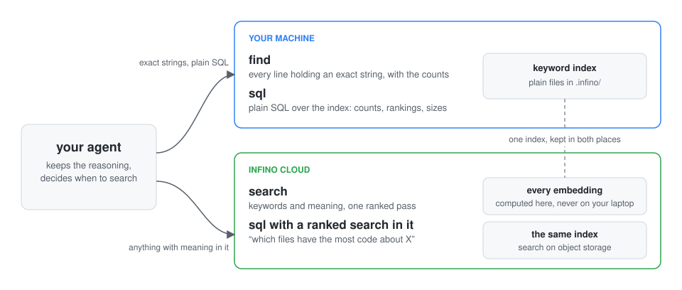
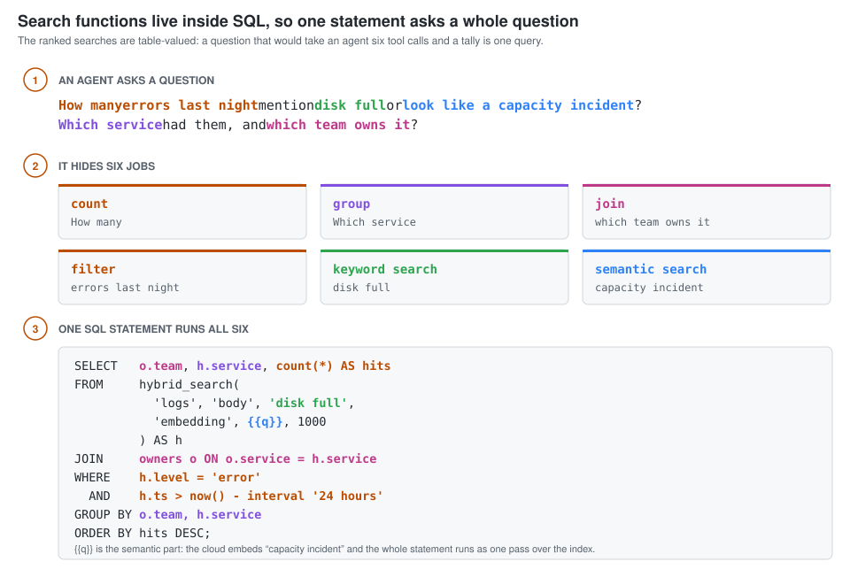
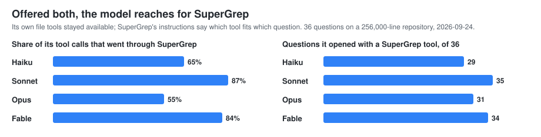
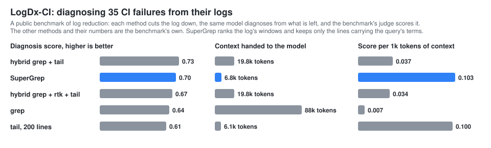
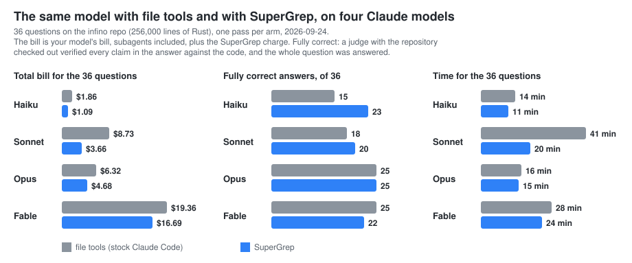
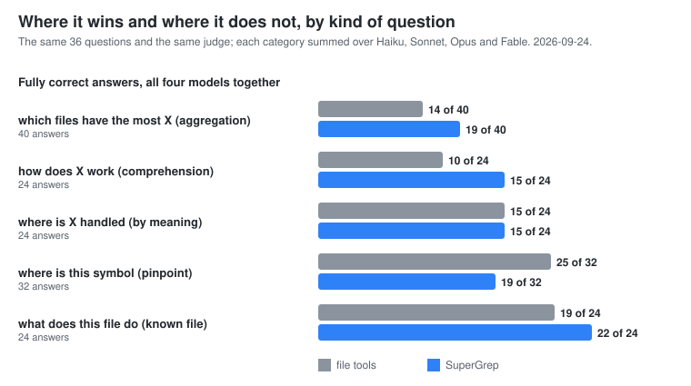
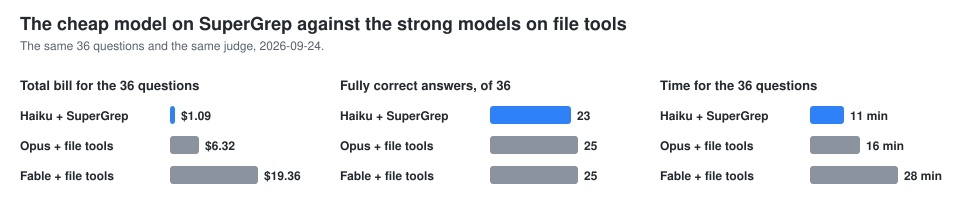

<div align="center">

[](https://github.com/infino-ai/supergrep/actions/workflows/ci.yml)
[](https://www.npmjs.com/package/@infino-ai/code-context)
[](LICENSE)

</div>

# SuperGrep

**Retrieval + inference offload for AI coding agents.** Help your agents find answers faster and at lower cost, while keeping the same answer quality. Particularly useful for cheaper models.

**[Try it live at infino.ai/supergrep](https://infino.ai/supergrep)** - put a question to a real codebase and watch the same model answer it with and without SuperGrep, side by side, with the bill for each. Supergrep uses Infino for retrieval, which tightly integrates small language models with indexes for scalable agent retrieval on object storage. 



SuperGrep offers agents three tools over an Infino index, kept in two places. `find` and plain `sql` run on your machine, over the keyword index. Conversely, anything with meaning in it - `search`, and a `sql` statement with a ranked search inside it - runs in the Infino cloud, so heavy compute and embeddings stay off your laptop. Your agent keeps the reasoning, writes the answer, and decides when to use SuperGrep. No configuration.

<details>
<summary>The three tools, one line each - for the agent reading this</summary>

| tool | what it does |
|---|---|
| `find` | Every line containing an exact string, like `grep -n`: complete, unranked, with the repo-wide total and per-file counts. Tens of milliseconds from the index. |
| `search` | One ranked pass fusing exact keyword matching with semantic similarity, so it works whether or not you know the words. Hits carry the code, cited `path:line`. |
| `sql` | Read-only SQL over the index. The ranked searches are table-valued, so "which files have the most code about X" ranks and tallies in one query. |

</details>



## What people use it for

- **Code review.** The reviewer's question is "what else calls this, and what breaks if it changes". `find` answers with every caller and the counts in one call, so the review is about the change rather than about finding it.
- **Several codebases at once.** Every local tool takes a repository path, so one session roams across every repo it touches - the service, the client, the shared library - without a checkout per question.
- **Code, logs and issues together.** Index the logs, the test output and the issue export beside the source, and "why did this integration test start failing?" is one question over all of them.

## Your agent reaches for it on its own



The model's own file tools stayed available throughout. What it had from SuperGrep was the server's instructions, which say which tool fits which kind of question; the choice on each call was the model's. The calls that are not SuperGrep are mostly `Read`: the model opens a file *after* the index has told it which one, rather than instead of asking. That is the shape you want - the index does the finding, and the model still opens what it needs to quote.

## Go beyond code - index your entire laptop or any corpus

SuperGrep looks across all the files a question needs, not just the source. Logs, test output, stack traces, CI output, configuration and docs go in beside the code -
`.log`, `.out`, `.err`, `.jsonl` and `.ndjson` are chunked at record boundaries, so a stack trace stays with the message that explains it -
and the same three tools run over all of it: `find` for an exact stack frame, `search` for a failure you can only describe, and `sql` to count and rank across a
run.

That matters most where a frontier model is weakest. A log is the pathological case for a context window - large, repetitive, mostly irrelevant, and paid for
again on every turn it stays in the transcript. An index collapses it to the spans that matter before the model sees any of it. On a public benchmark of CI-failure diagnosis, scored by the benchmark's own judge, that puts SuperGrep second on the score and first by a distance on score per token of context:



For files that don't fit on your laptop - write them out to Parquet files in object storage and point SuperGrep at them without ever loading them onto your laptop ([how](#indexing-from-object-storage)). You can search them together with your code or laptop files using the same tools.

## What it saves

The same model, the same 36 questions about a 256,000-line codebase, with and without SuperGrep. Every answer was checked against the code. **Fully correct** means every claim held and the whole question was answered. The bill is everything you pay: your model, its subagents, and SuperGrep.

<details>
<summary>How the runs were set up</summary>

Real agent runs through the Claude Agent SDK, the same minimal prompt in every arm, on the [infino](https://github.com/infino-ai/infino) engine repository, measured 2026-09-24. Thirty-six questions in five categories: aggregation (10), comprehension (6), by meaning (6), pinpoint (8), known file (6). The file-tools arm is stock Claude Code: Glob, Grep, Read, LS, Bash, and the Agent tool with the built-in Explore subagent. The SuperGrep arm is the same plus SuperGrep's MCP tools. The judge is Opus 5.5.

</details>



**Your mileage will vary with the model.**

- **Cheaper on every model.** Haiku 41% off the total bill, Sonnet 58%, Opus 26%, Fable 14%.
- **Quality increases on the cheaper models.** Haiku gets eight more fully correct answers with SuperGrep than without. On Sonnet, Opus and Fable the answers are level: the judge is itself a model, and graded four times the same answers came back with 19, 20, 17 and 23 claims it could not verify, so a difference under about six answers in 36 is noise, and those three are inside it.
- **No surprise bills.** On about a third of the questions, Sonnet with file tools sends a subagent off to read through the repository. That one question then costs four to five times as much and takes four times as long. With SuperGrep it asks the index instead. Over the 36 questions that is $3.66 against $8.73 and 20 minutes against 41, with 20 fully correct answers against 18.
- **On your own code the gap is wider.** These runs are on a public, open-source repository, because that is a test anyone can repeat - and the large models have seen it in training, which is a head start for reading files. On a private codebase the model has never seen, the index does more of the work, and the effect of SuperGrep is larger.

### Where it wins, and where it does not



It wins on questions about the whole codebase: counts, rankings, every occurrence. Grep gives the first forty matches; an index gives the total. It loses on finding one named thing with a large model, which reads whole files well.

### The cheapest model with SuperGrep against the most expensive without



23 correct answers to their 25, for $1.09 instead of $6.32 (Opus) or $19.36 (Fable).

## Install

Two commands, once per machine. You need [Claude Code](https://claude.com/claude-code) and Node.js 22.19 or newer, on macOS or Linux.

```bash
claude plugin marketplace add infino-ai/supergrep
claude plugin install supergrep@infino-ai
```

(The plugin was called `code-context` before; an earlier install is replaced with `claude plugin uninstall code-context@infino-ai` and the two commands above. The MCP server inside keeps its name, so nothing the agent learned changes.)

That is the setup. Open Claude Code in any directory - a repository, a folder of logs, your notes, anything - and ask a question. The first question indexes the directory, and `find`, `sql` and `read` answer from then on. Nothing is configured per directory, no account exists yet, and nothing has left your machine.

`search` is the cloud half - the embeddings run on the Infino platform, over a copy of the index kept there - and it needs an account. The first time a question needs it, Claude tells you the one command and does not run it, because it is yours to run. Once, in a terminal:

```bash
npx -y @infino-ai/code-context login --platform https://api.supergrep.infino.ai
```

**A free account, no credit card required.** There is no form, no email, no password and no card, and nothing is created without your say-so: the command tells you that the contents of the directories you use `search` in will be uploaded to Infino, asks, and only on your yes creates the account and stores its key at `~/.infino/key`, mode 600, readable only by you. No config file ever holds a key or a path to one. Infino is SOC 2 Type 2 certified.

**Keep that key.** Because the free account asks for no email and no card, the key is the only thing that identifies you: it is how you get back in, and nothing else can. Back it up somewhere safe. When you add your details in the Infino console the same account gains a sign-in, and keys can be managed from there.

Restart the session and every directory you open has all three tools. Each one gets its own database on your account, named after the directory and loaded the first time you use `search` there - a directory you only ever `find` in is never uploaded. One server answers for every directory a session touches: the tools take a `path`, so a session that spans several projects names the one it means. When the free credit runs out, add billing details and a card to the same account; `find` and plain `sql` keep working throughout.

### If you already have an Infino account

Sign in once per machine instead. The key comes from a file or standard input, never from an argument - argv is readable by every process on the machine - and `--yes` is the same agreement the sign-up asks for, since a piped key leaves no terminal to ask on:

```bash
npx -y @infino-ai/code-context login --db https://api.supergrep.infino.ai --yes < keyfile
```

### Other MCP clients, and one entry per repository

Cursor, Codex CLI, Gemini CLI, Windsurf and Cline take the same server over stdio. `cx install` in a repository writes its entry into `.mcp.json` there (`--config` for another client's file); with the account stored it names the repository's database and nothing else, `--local-only` writes the keyword-only entry, and `install --platform https://api.supergrep.infino.ai` is the sign-up and the entry in one for a machine with no account. [The reference](docs/reference.md#cli) has every flag, and [CONTRIBUTING](CONTRIBUTING.md) how to build from source.

### Hermes

[Hermes](https://github.com/NousResearch/hermes-agent) loads SuperGrep as a plugin, `hermes_supergrep/` in this repository: a profile names the repositories it reads, the plugin starts the server over them, registers the `code-context` skill as `supergrep:code-context`, and syncs every repository that has a finished index in the background when a session starts. A repository with no index yet is built by the server on its first query, or ahead of time by `hermes supergrep index`; one whose vectors are still being built is left to the server, which also rebuilds one whose build stopped before it finished (a server killed mid-build) on its next query, unless `CX_TABLE` names a platform table the server does not own; then `hermes supergrep index` rebuilds it. One process at a time writes an index: a session-start sync that finds the server, or another `cx index`, writing the same one skips it (`cx index` exits 75 and writes nothing). Memory stays whatever plugin the profile uses for it; this one keeps to the code, and the two load side by side.

**1. Build the client.** Node.js 22.19 or newer; Hermes's installer keeps one in `~/.hermes/tools/`.

```bash
git clone https://github.com/infino-ai/supergrep.git
cd supergrep
export PATH="$(ls -d ~/.hermes/tools/node-*/bin | sort -V | tail -n 1):$PATH"
npm ci && npm run build
```

**2. Install the plugin.** Hermes copies the plugin directory out of the repository; it has no Python dependencies.

```bash
hermes plugins install https://github.com/infino-ai/supergrep/tree/main/hermes_supergrep --enable
```

**3. Add the tools**, naming the client from step 1 and the repositories the profile reads, first one first: it is the tools' default root, and the others are reached by the `path` each tool takes.

```bash
hermes config set mcp_servers.supergrep.command hermes
hermes config set mcp_servers.supergrep.args '["supergrep", "mcp"]'
hermes config set mcp_servers.supergrep.env.SUPERGREP_CLIENT /full/path/to/supergrep/dist/cli.js
hermes config set mcp_servers.supergrep.env.SUPERGREP_REPOS /full/path/to/repo-one,/full/path/to/repo-two
hermes config set mcp_servers.supergrep.connect_timeout 120
```

`hermes supergrep status` says whether Node, the client and each repository are in place, and `hermes supergrep index` indexes them now: a first build where there is no index, a sync where there is. The session-start sync runs with the same `env` block as the server, so file settings there (`CX_INCLUDE`, `CX_NO_IGNORE`, ...) hold for both. The block takes `SUPERGREP_NODE` for a Node other than the one on Hermes's path (without it, the first `node` on `PATH`, else Hermes's own under `~/.hermes/tools`), `SUPERGREP_AUTO_INDEX=off` to leave syncing to the first query, and `SUPERGREP_MCP_SERVER` when the entry is named something other than `supergrep` (environment only, since it names the block). `search` needs the account from the [install](#install) above, stored once per machine, as with any other client. With the account stored, each sync also loads the repository's changes into its own database on the platform, so every named repository with an index uploads at each session start; `SUPERGREP_AUTO_INDEX=off` leaves that to the first query on each.

## Indexing it yourself

The first question in a directory indexes it and the MCP server keeps it current, so most of the time you never run an index by hand. When you want to - a first pass over a huge tree, a CI step, a corpus that is not a git repository - `index` is the command. (`cx` below is `npx -y @infino-ai/code-context`, or `cx` itself after `npm install -g @infino-ai/code-context`.)

```bash
cx index                      # bring the index up to date; incremental, full on first run
cx index ~/notes              # index some other directory
cx index --full               # force a full rebuild
cx index --watch              # keep watching the tree and sync on every change
cx index --no-embed           # signed in: load the platform table without vectors
cx index --max-files 1000000  # raise the cap past the 500,000 default; over it, the index is
                              # partial and says so, with the value to pass to get all of it
```

The index is plain files under `.infino/` in the directory you indexed. Keyword search is live within seconds of the first `cx index`. The local index stays keyword-only: search by meaning runs on the platform copy, once you are signed in. `cx status` says what the index holds and how fresh it is.

Signed in, `cx index` loads the platform copy in the same pass - the directory's own database on your account, so `search` sees the same content as `find`. To load a database you name instead:

```bash
cx index --db https://api.supergrep.infino.ai/<database>
```

`--embed-provider platform` (the default) has the platform fill that table's vectors with its own model, server-side; `local` embeds on this machine and ships the vectors instead.

## Your data, through the same tools

The same plugin reaches every table in your Infino account, not only the directories it indexed. Signed in, the agent has three more tools and a `database` argument on the three it had:

| tool | what it does |
|---|---|
| `tables` | What the account holds: every database with its tables; a table's columns, which are indexed for search and which the platform embeds, the column that names a row, and the table's card - statistics, sample rows and what each column means. |
| `hydrate` | Load a dataset into a database of the account, from wherever it is: a bucket prefix the platform reads itself, files on your laptop, files on a machine you reach with `ssh`, or a prefix already in the database's storage. Parquet, CSV, NDJSON, Iceberg and parsed documents. The database is created if it is new; the load runs on the platform and `hydrate_status` follows it. |
| `hydrate_status`, `hydrate_cancel` | Where a load stands; stop one. |

`sql`, `search` and `find` take `database` (and `table`) to run over a table of the account instead of a repository - the statement, the ranked search and the exact match, with the platform's verdict on a statement's rows and its keys for a join, exactly as over code. So one session asks "which files call this" of the checkout and "which accounts moved the most money last quarter" of the data, through one MCP, and a question can span both.

Nothing is configured per table or per database. Point the agent at a folder of CSVs, a Parquet export, a bucket, or a directory on a dev box, and ask it to load it; then ask questions. Files on your laptop or on a remote machine go straight into the database's storage over the platform's upload sessions (`ssh` is yours: the plugin runs one `find` and one `cat` per file over it and installs nothing there); a bucket is read in place and nothing is copied.

### As a connector, with sign-in

The same server runs over Streamable HTTP, as one URL that claude.ai, Claude Desktop, Claude Code and any other MCP client add as a remote connector:

```sh
cx mcp --http 9121 --db https://<platform> --sign-in https://<host>/.well-known/oauth-protected-resource/mcp
```

With `--sign-in`, every call carries an Infino account's key, and a call with none is told where to sign in (the OAuth resource metadata at that URL), which is how Claude knows to sign the person in. Every call then runs on that account's own databases. Without it, every session runs on the one account the process was started with (add `--read-only` for a URL shared with no sign-in).

## Indexing from object storage

For a corpus too big for your laptop - years of logs, a document dump, anything you already keep in a bucket as Parquet or JSON - leave it there, point the platform at the bucket, and it builds the index from there. Nothing is copied, nothing is downloaded to your machine, and no row passes through your laptop or through the API. The `hydrate` tool above does this from inside a session; the API it calls is below.

**1. Grant read on your bucket** to Infino's service account - we give you its address - on the prefix you want indexed: `roles/storage.objectViewer` on GCS, `s3:GetObject` + `s3:ListBucket` on S3. Read only: the platform writes nothing there.

**2. Submit the job.** One `POST`, naming the bucket and prefix, and it returns straight away - the build runs on the platform, not in the request:

```bash
curl -sS -X POST https://api.supergrep.infino.ai/v1/hydrate/<database> \
  -H "authorization: Bearer $(cat ~/.infino/key)" \
  -H 'content-type: application/json' \
  -d '{
        "table": "logs",
        "source": { "kind": "bucket", "bucket": "<your-bucket>", "prefix": "exports/logs/" },
        "fts":    [ { "column": "message" } ],
        "embed":  { "column": "embedding", "source": ["message"] }
      }'
```

(A database that lives in your own bucket can also read shards staged under its own `_source/` prefix: `"source": { "kind": "prefix", "prefix": "_source/logs/" }`.)

```json
{ "job": "hydrate/<customer>/<database>/logs", "state": "pending" }
```

Leave `fts` and `embed` out and the job reads a sample and picks the roles itself. `columns` narrows which source columns are carried; `no_embed: true` builds no vector column at all.

**3. Follow it.** The reply carries the state, how far it has got, the schema it settled on, and what it has cost so far:

```bash
curl -sS "https://api.supergrep.infino.ai/v1/hydrate/<database>?table=logs" \
  -H "authorization: Bearer $(cat ~/.infino/key)"
```

States are `pending`, `running`, `cancelling`, `stopped`, `succeeded`, `failed`. A job that stopped - a cancel, or an outage that outlasted its budget - resumes from its own checkpoint rather than starting over:

```bash
# resume where it left off
curl -sS -X POST https://api.supergrep.infino.ai/v1/hydrate/<database> -H "authorization: Bearer $(cat ~/.infino/key)" \
  -H 'content-type: application/json' \
  -d '{"table":"logs","source":{"kind":"bucket","bucket":"<your-bucket>","prefix":"exports/logs/"},"resume":true}'

# stop a running job at its next commit boundary
curl -sS -X DELETE "https://api.supergrep.infino.ai/v1/hydrate/<database>?table=logs" \
  -H "authorization: Bearer $(cat ~/.infino/key)"
```

By default a job that fails for good drops its half-built table, so a partial table is never served; `"on_failure": "keep"` keeps what was committed.

The table is then searchable like any other, and one question can span it and your code at once.

Note: Hydrate API needs to be enabled per account. Contact support@infino.ai to enable.

## Learn more

- [Reference](docs/reference.md) - tools, flags, configuration, CLI, architecture.
- [FAQ](docs/faq.md), [Tradeoffs](docs/tradeoffs.md) - the honest limits.

## License

Apache-2.0
